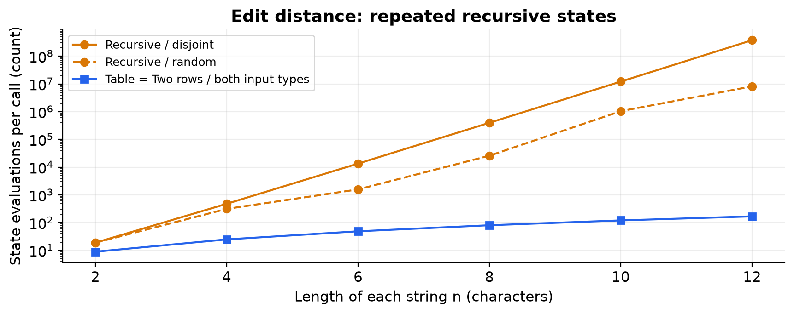
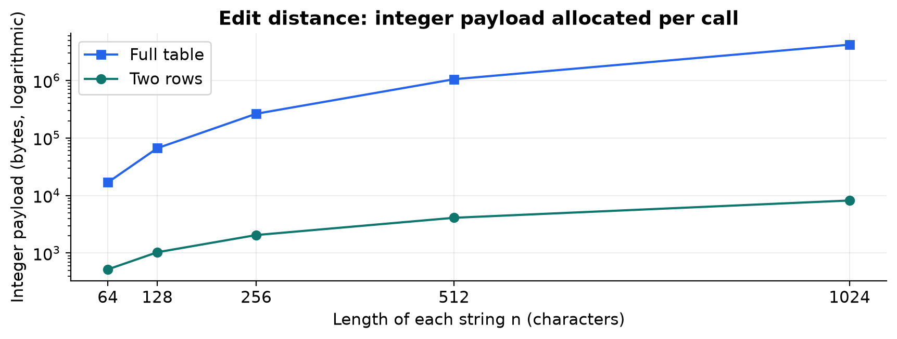
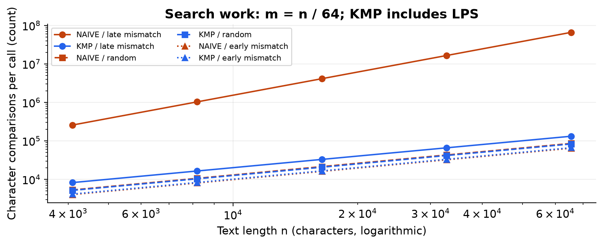
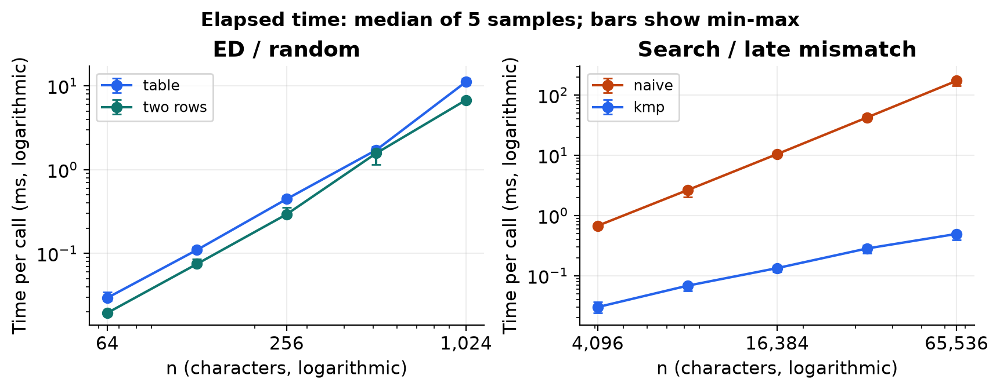

# Experiment Design Card

Author: Zhursin Sirnebayev, SE-2509. Frozen before any algorithm tests or timing runs.

| Field | Plan written before the first run |
| --- | --- |
| Question: edit distance | How does repeated recursive work grow compared with DP, and how much integer storage do two rows save? |
| Question: string search | When the pattern grows with the text, does a late mismatch cause quadratic Naive work while KMP stays linear? |
| Sizes | Recursive ED: n = 2, 4, 6, 8, 10, 12; both strings have length n. Both DP versions use those same sizes and 64, 128, 256, 512, 1024. Search: text n = 4096, 8192, 16384, 32768, 65536 and pattern m = n / 64 (64..1024). Every algorithm has at least four sizes and a largest/smallest ratio of at least four. The recursion cap prevents runaway work; larger DP/search sizes give measurable times. |
| ED inputs and purpose | random: independent lowercase strings over a fixed 4-letter alphabet, exposing typical mismatches; disjoint: a^n versus b^n, so every non-base recursive state branches three ways. The disjoint case deliberately stresses plain recursion. |
| Search inputs and purpose | random: independent lowercase text/pattern over a fixed 4-letter alphabet, exposing early mismatches; late_mismatch: text a^n and pattern a^(m-1)b, making Naive compare m characters at every legal alignment; early_mismatch: text a^n and pattern b^m, a best-case contrast with one comparison per alignment. |
| Generator | Custom deterministic Java xorshift64* generator, seed 20261103. Each (family,input,n,m) gets its own derived seed, so algorithm order never changes input. SHA-256 fingerprints in CSV verify identical inputs. |
| Metrics | Five timed samples after three untimed warm-ups for every case. Each sample batches calls until at least 20 ms (minimum one call); record elapsed/batch as time_ms, then use the median of five. ED counts actual recursive calls / evaluated DP cells and character comparisons. Search counts text-pattern comparisons and LPS comparisons separately. Count allocated integer slots at allocation sites, measuring DP payload rather than claiming to measure total heap. |
| Prediction | Disjoint recursion grows exponentially; bottom-up state work is quadratic in n. Table storage grows quadratically, two-row storage linearly, but no universal timing winner is assumed. With m=n/64, late-mismatch Naive comparisons grow quadratically, KMP including preprocessing linearly; random and early-mismatch Naive should look roughly linear. Timing may be noisy or reordered by JIT, allocation and caching. |
| Plots | (1) Small ED work vs n, logarithmic y, to expose repeated work. (2) Large ED integer payload vs n, logarithmic y, to show the memory tradeoff. (3) Search comparisons including LPS vs n, log-log, for all three input types. (4) Median time with min-max ranges: large DP and late-mismatch search, log-log, to relate operation counts to elapsed time. Each figure has units, legend and a one-sentence takeaway in the report. |
| Reproduction / budget | Run the packaged Java experiment from the project root. Counters, outputs and fingerprints must be identical across runs; wall-clock times cannot be identical on a real computer. Results have one row per timed sample, not just medians. No input-plan changes are intended. n=12 is the largest planned recursive size, not a claim that larger strings are impossible. |

No measurements existed when this card was saved. The first Git commit records this plan; later commits add algorithms, tests, and only then measurements.

# Assignment 4 - Results and conclusions

Zhursin Sirnebayev | SE-2509

The companion REPORT.pdf is the fixed-layout, four-page submission version.

## Edit Distance

Figure 1. Disjoint recursion revisits hundreds of millions of states while both DP variants evaluate only 169 cells at n=12.

Figure 2. At n=1,024, two rows use 8,200 bytes of integer payload versus 4,202,500 bytes for the full table.

Prediction vs result (Edit Distance). The predicted repeated-work explosion occurred: at n=12, disjoint recursion entered 377,393,953 calls, versus 169 evaluated cells in either DP version. Random recursion entered 8,170,022 calls because equal characters sometimes take only the diagonal branch. DP evaluates the same (n+1)^2 cells for both input types; on the large sizes, doubling n approaches four times as many cells. At n=1024, measured integer payload was 4,202,500 bytes for the table and 8,200 bytes for two rows, a 512.5x reduction, matching the quadratic/linear storage prediction.

Measurement scope. A recursive call and a DP cell are both state evaluations, but they do not have identical instruction costs. Integer bytes are measured allocated slots multiplied by four; array headers, row references, input strings, recursion stack and JVM heap overhead are excluded. No edit-plan changes were made after the pre-run card.

## String search and timing

Figure 3. Growing the pattern with n makes late-mismatch Naive work quadratic, while KMP including LPS remains linear.

Figure 4. Median timings broadly follow the work curves, but visible ranges and execution overhead limit precise speed claims.

Prediction vs result (string search). With m=n/64, each doubling of n made late-mismatch Naive work almost four times larger, while KMP work including LPS almost doubled. At n=65,536 and m=1,024, the measured counts were 66,061,312 versus 132,094, a 500.1x gap. Random and early-mismatch counts grew roughly linearly as predicted. Early-mismatch Naive made fewer comparisons than KMP including LPS, yet its largest-case median was slower; comparison counts omit branch behavior and execution costs, so this timing difference is an observation, not proof of a particular hardware cause.

Measured time. Times are normalized milliseconds per invocation, with three untimed warm-ups and five independent timed batches of at least 20 ms per case; figures use medians and min-max ranges. KMP includes LPS construction, and all algorithms include counters, allocation, result consumption and small harness checks. At n=1,024 on random ED, table/two-row medians were 11.179/6.785 ms; on the largest late-mismatch search they were 172.586 ms for Naive and 0.495 ms for KMP. JIT compilation, caching, garbage collection and desktop background work can change these values, especially tiny cases; counters provide the stronger evidence about growth. These are instrumented educational measurements, not a JMH benchmark.

## Short answers

### Which input made string search slowest?

The largest late_mismatch input made Naive slowest among the submitted search cases. The text is all a, while the pattern contains a long run of a followed by b, so each legal alignment fails only after m comparisons and produces no match. Naive performed 66,061,312 comparisons, exactly matching (n-m+1)*m when checked after measurement. KMP retains prefix information and never moves its text index backwards, avoiding those repeated prefix scans.

### How large an n could recursive Edit Distance handle?

The largest tested recursive size was n=12, with a disjoint median of 1320.94 ms and 377,393,953 calls per invocation. The measured call count grew by 31.1x from n=10 to n=12. I stopped at the predeclared cap because repeated subproblems rapidly exhaust the experiment's time budget, not because a stack overflow or timeout was observed. This is a practical tested boundary for the chosen worst case, not a universal maximum; equal strings follow only one branch.

### What do two rows gain and lose?

Two rows preserve the exact distance and O(n*m) time while reducing extra integer storage from O(n*m) to O(m), saving 512.5x payload at n=m=1,024 here. They overwrite previous rows, so a simple traceback cannot directly reconstruct the edit sequence. A full table is easier to inspect and supports ordinary traceback, while reconstruction with reduced storage requires extra computation or a different reconstruction technique. Two rows were faster at the largest random size in this run, but that is not a universal speed guarantee.

### Which search would you choose for the city platform?

I would choose KMP for exact pattern search in long operator logs because its O(n+m) work remains bounded on repetitive or adversarial input. Its LPS array costs O(m) extra storage, and retaining the longest border after a match preserves overlapping results. Naive remains a reasonable small-input baseline, but its worst case scales as O(n*m). For residents' misspelled street names, I would use the two-row Edit Distance routine to rank candidates; exact KMP matching by itself does not correct spelling.

Validation and reproducibility. All 244 JUnit 5 tests passed with no failures, errors or skipped tests: reference values, empty/long patterns, overlaps, 100 random ED pairs, 100 random search texts, brute-force LPS checks and counter resets. The primary CSV has 430 timed samples across 86 cases; summary.csv contains all 86 medians. A second complete execution is retained in reproducibility.csv, and its outputs, input SHA-256 values and per-call counters agree in all 430 rows; timing and batch lengths are deliberately excluded from equality checks.

Environment: Windows 11 amd64, Oracle Java HotSpot 25.0.1, 8 logical processors, -Xms256m -Xmx1g; compiled for Java 17. CPU model was not available through the sandbox query and is not inferred. Seed: 20261103; all times were collected serially on the same machine.
